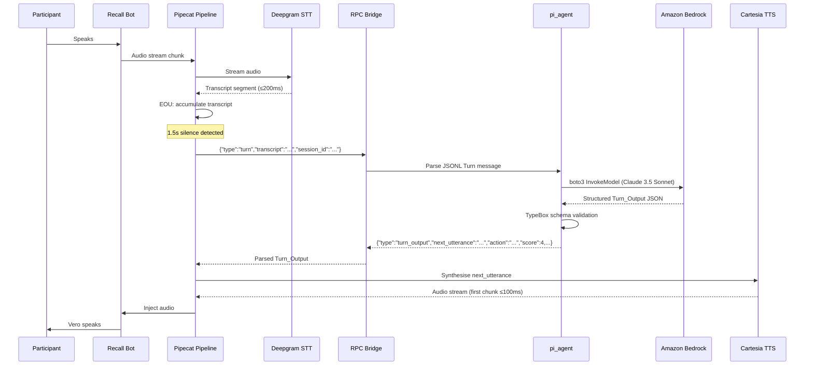
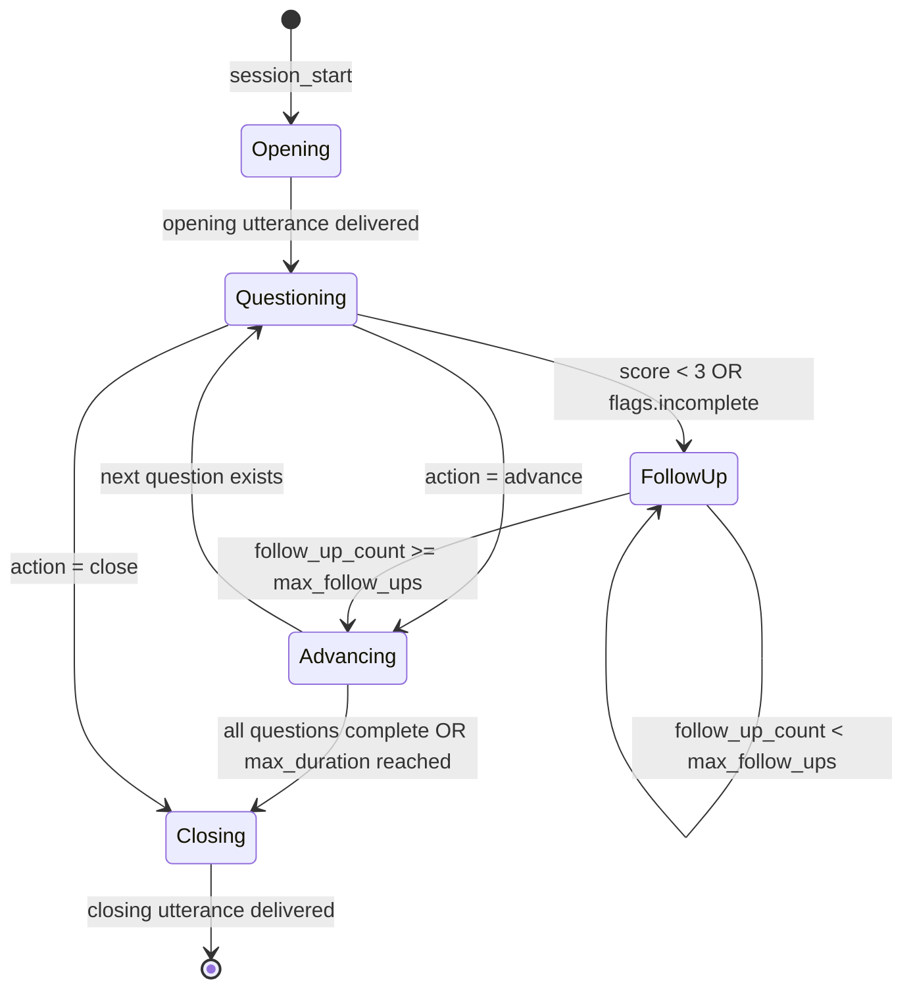

# Design Document: Vero AI Agent

## Overview

Vero is a configurable AI conversation agent that joins Microsoft Teams meetings as a named participant and drives structured conversations autonomously. The system is built around a config-only Skill Pack architecture: swapping a YAML file transforms Vero from a technical interviewer into a sales coach, discovery agent, or compliance auditor — with zero code changes.

The POC targets the Interviewer Skill Pack: Vero joins a live Teams meeting, conducts a full technical screening, scores candidate responses per-turn against a rubric, and emails a hire/no-hire scorecard within 60 seconds of call end.

### Key Design Decisions

- **Process boundary between audio and intelligence**: Pipecat (Python) owns the real-time audio frame pipeline; pi_agent (Node.js/TypeScript) owns conversation intelligence. These communicate over a stdin/stdout JSONL RPC bridge — a clean, testable boundary that allows independent scaling and replacement of either layer.
- **Single Docker container**: Python + Node.js co-hosted in one container on EC2 t3.medium. Pipecat spawns pi_agent as a child process. Simplifies POC deployment at the cost of independent scaling (acceptable for POC).
- **Recall.ai for Teams integration**: Abstracts the complexity of the Microsoft Graph Real-time Media Platform. The bot joins as a named participant and handles audio I/O via webhooks. The only unavoidable Azure dependency is the AD app registration for OAuth 2.0.
- **TypeBox schema enforcement**: All structured outputs from pi_agent are validated against TypeBox schemas before reaching downstream consumers. Invalid outputs trigger a single LLM retry with the validation error appended to the prompt.
- **Cartesia-first TTS with ElevenLabs fallback**: Cartesia Sonic delivers first audio chunk in under 100ms, which is the critical path for the p90 ≤ 4s latency budget.
- **AWS Bedrock for all LLM calls**: All LLM inference goes through Amazon Bedrock (Claude 3.5 Sonnet, Titan, etc.) rather than direct vendor APIs. No Anthropic/OpenAI/Google API keys needed. Authentication uses the AWS credential chain: locally via an SSO profile (`AWS_PROFILE`), on EC2 via the instance IAM role (no credentials in env at all).
- **PostgreSQL for session persistence**: Session state, turn transcripts, scores, and latency records are persisted to a PostgreSQL database. This enables report generation after container restarts, post-hoc analysis, and future cross-session memory. For the POC, Postgres runs as a sidecar Docker container in the same `docker-compose.yml`.

---

## Architecture

```mermaid
graph TB
    subgraph "Teams Meeting"
        TM[Teams Meeting Audio/Video]
    end

    subgraph "Recall.ai"
        RB[Recall Bot\nManaged Bot Instance]
    end

    subgraph "Docker Container - EC2 t3.medium"
        subgraph "FastAPI Backend (Python)"
            API[Backend API\nFastAPI]
            WH[Webhook Handler\n/recall/webhook]
            SM[Session Manager\nIn-memory state]
            RG[Report Generator]
        end

        subgraph "Audio Pipeline (Python - Pipecat)"
            AC[Audio Capture\nRecall.ai stream]
            STT[Deepgram Nova-3\nStreaming STT]
            EOU[EOU Detector\n1.5s silence threshold]
            TTS[TTS Injector\nCartesia / ElevenLabs]
        end

        subgraph "RPC Bridge"
            JSONL[stdin/stdout JSONL\nProcess boundary]
        end

        subgraph "Conversation Engine (Node.js - pi_agent)"
            PA[pi_agent\n@mariozechner/pi-agent]
            PAI[pi_ai\n@mariozechner/pi-ai]
            SP[Skill Pack State\nIsolated per session]
        end
    end

    subgraph "AWS"
        BR[Amazon Bedrock\nClaude 3.5 Sonnet]
    end

    subgraph "External Services"
        DG[Deepgram Nova-3\nSTT API]
        CT[Cartesia Sonic\nTTS API]
        EL[ElevenLabs\nTTS Fallback]
        SG[Resend\nEmail]
        BF[Bot Framework\nTeams Chat]
        AAD[Azure AD\nOAuth 2.0]
    end

    subgraph "Docker Compose - EC2 t3.medium"
        PG[PostgreSQL 16\nSidecar Container]
    end

    TM <-->|Audio stream| RB
    RB -->|Webhook events| WH
    RB <-->|Audio injection| TTS
    WH --> SM
    SM --> AC
    AC --> STT
    STT <-->|Streaming| DG
    STT --> EOU
    EOU -->|Turn transcript| JSONL
    JSONL <-->|Turn_Output| PA
    PA --> PAI
    PAI <-->|Bedrock InvokeModel| BR
    SM --> PG
    RG --> PG
    PA --> SP
    JSONL -->|next_utterance| TTS
    TTS <-->|Synthesis| CT
    TTS <-->|Fallback| EL
    SM --> RG
    RG -->|Email| SG
    RG -->|Teams summary| BF
    API <-->|Join/leave| RB
    API <-->|Auth| AAD
```

### Request Flow: Turn Processing



---

## Components and Interfaces

### 1. Backend API (FastAPI)

The orchestration layer. Handles Recall.ai webhooks, session lifecycle, and report delivery.

**Endpoints:**

| Method | Path | Description |
|--------|------|-------------|
| `POST` | `/sessions` | Create a new session: validate Skill Pack, trigger Recall.ai bot join |
| `GET` | `/sessions/{session_id}` | Get session status and current state |
| `DELETE` | `/sessions/{session_id}` | Manually terminate a session |
| `POST` | `/recall/webhook` | Receive Recall.ai events (bot_joined, bot_left, audio_ready) |
| `POST` | `/skill-packs/validate` | Validate a Skill Pack YAML without starting a session |
| `GET` | `/health` | Health check with dependency status |

**Session creation flow:**
1. Parse and validate Skill Pack YAML (reject with field-level errors if invalid)
2. Call Recall.ai API to create a managed bot with `agent.name` as the display name
3. Authenticate with Azure AD using OAuth 2.0 (`Calls.JoinGroupCall.All`, `Calls.AccessMedia.All`)
4. Persist session state to PostgreSQL (keyed by `session_id`)
5. Return `session_id` to caller; bot join is async (webhook confirms join)

**Retry logic:**
- Recall.ai join: one retry after 10s timeout, then error
- Resend email: one retry after 30s on delivery failure
- pi_agent process: restart on RPC bridge interruption

### 2. Audio Pipeline (Pipecat)

Manages the real-time audio frame pipeline. Runs as a long-lived Python process per session.

**Pipeline stages:**

```
Recall.ai audio stream
    → Deepgram Nova-3 STT (streaming, speaker diarisation)
    → Transcript accumulator (per-speaker segments)
    → EOU Detector (1.5s silence threshold)
    → [on turn complete] RPC Bridge send
    → [on Turn_Output received] TTS Injector
    → Recall.ai audio injection
```

**EOU Detector behaviour:**
- Monitors energy level and silence duration
- Fires `turn_complete` event after 1.5s continuous silence following participant speech
- Suppressed while `vero_speaking` flag is set (prevents self-triggering)
- Silence timer resets on any non-silence audio frame

**TTS Injector:**
- Primary: Cartesia Sonic (voice ID from `agent.tts_voice`)
- Fallback: ElevenLabs (triggered on Cartesia HTTP error or timeout >500ms)
- Sets `vero_speaking = True` before first audio chunk, `False` after last chunk
- Logs fallback events with timestamp and error reason

**Deepgram reconnection:**
- On connection drop: attempt reconnect within 2s
- Buffer audio frames during reconnect window
- Log interruption with session_id and timestamp

### 3. RPC Bridge (stdin/stdout JSONL)

The process boundary between Pipecat (Python) and pi_agent (Node.js). Each message is a single JSON object terminated by a newline.

**Message types (Pipecat → pi_agent):**

```jsonc
// Turn transcript
{
  "type": "turn",
  "session_id": "sess_abc123",
  "speaker": "participant",
  "transcript": "I designed a distributed cache using consistent hashing...",
  "turn_index": 5,
  "timestamp_ms": 1712345678901
}

// Session start
{
  "type": "session_start",
  "session_id": "sess_abc123",
  "skill_pack": { /* full SkillPack object */ }
}

// Session end
{
  "type": "session_end",
  "session_id": "sess_abc123",
  "reason": "all_questions_complete" // | "max_duration_reached" | "manual"
}

// Silence timeout
{
  "type": "silence_timeout",
  "session_id": "sess_abc123",
  "silence_duration_ms": 8000,
  "consecutive_count": 1
}
```

**Message types (pi_agent → Pipecat):**

```jsonc
// Turn output
{
  "type": "turn_output",
  "session_id": "sess_abc123",
  "turn_index": 5,
  "next_utterance": "That's a solid approach. Can you walk me through how you handled cache invalidation?",
  "action": "follow_up",
  "question_id": "q_system_design_1",
  "score": null,
  "score_rationale": null,
  "competency": "system-design",
  "flags": ["incomplete"]
}

// Session summary (on session_end)
{
  "type": "session_summary",
  "session_id": "sess_abc123",
  "scores": [
    { "question_id": "q_system_design_1", "competency": "system-design", "score": 4, "rationale": "..." }
  ],
  "transcript": [ /* full turn-by-turn transcript */ ],
  "questions_not_reached": []
}
```

**Validation:** Both sides validate message schema on receipt. Invalid messages are logged and a `{"type":"error","message":"..."}` response is sent. The session is not terminated on a single invalid message.

### 4. Conversation Engine (pi_agent)

Runs as a Node.js child process. Manages one `pi_agent` session per Vero session.

**Per-turn processing:**
1. Receive `turn` message from RPC bridge
2. Append transcript to in-session memory
3. Build LLM prompt: persona + Skill Pack state + rubric + full transcript + scoring history
4. Call LLM via `pi_ai` using `agent.model_preferences` provider order — all calls routed through Amazon Bedrock using the AWS credential chain (SSO profile locally, EC2 instance role in production)
5. Validate response against TypeBox `Turn_Output` schema
6. On validation failure: retry once with error appended to prompt
7. Apply conversation flow rules (follow-up count, max_follow_ups, off-topic redirect)
8. Send `turn_output` back over RPC bridge

**Conversation flow state machine:**



**Silence handling state:**
- `silence_timeout` with `consecutive_count = 1`: generate gentle prompt (references topic, not verbatim question)
- `silence_timeout` with `consecutive_count = 2`: set `action = advance`, move to next question

### 5. Report Generator

Triggered by `session_summary` from pi_agent. Runs within the Backend API process.

**Report types (from `report.template`):**
- `scorecard`: per-question scores, competency summary, hire/no-hire recommendation, optional transcript
- `discovery-brief`: opportunity summary, BANT/MEDDIC fields, next steps
- `audit-log`: Q&A log with timestamps, compliance flags
- `coaching-report`: performance scores, improvement areas, example exchanges

**Delivery:**
1. Generate report content (JSON → formatted text/HTML)
2. Send via Resend to all `report.email_to` addresses (one retry on failure after 30s)
3. Post text summary to Teams meeting chat via Bot Framework
4. Log delivery status with timestamps

---

## Data Models

### SkillPack

```typescript
// TypeBox schema (used for validation in pi_agent)
import { Type, Static } from '@sinclair/typebox'

const ModelPreference = Type.Object({
  provider: Type.Literal('bedrock'),  // all LLM calls go through Amazon Bedrock
  model: Type.String()                // Bedrock model ID, e.g. "anthropic.claude-3-5-sonnet-20241022-v2:0"
})

const Question = Type.Object({
  id: Type.String(),
  text: Type.String(),
  probes: Type.Array(Type.String()),
  competency: Type.String(),
  max_follow_ups: Type.Integer({ minimum: 0, maximum: 10, default: 2 })
})

const Section = Type.Object({
  id: Type.String(),
  title: Type.String(),
  questions: Type.Array(Question)
})

const RubricEntry = Type.Object({
  competency: Type.String(),
  scores: Type.Object({
    '1': Type.String(),
    '2': Type.String(),
    '3': Type.String(),
    '4': Type.String(),
    '5': Type.String()
  })
})

const ReportConfig = Type.Object({
  template: Type.Union([
    Type.Literal('scorecard'),
    Type.Literal('discovery-brief'),
    Type.Literal('audit-log'),
    Type.Literal('coaching-report')
  ]),
  email_to: Type.Array(Type.String({ format: 'email' })),
  include_transcript: Type.Boolean({ default: true })
})

export const SkillPackSchema = Type.Object({
  skill: Type.Object({
    id: Type.String(),
    name: Type.String(),
    version: Type.String() // semver
  }),
  agent: Type.Object({
    name: Type.String(),
    persona: Type.String(),
    language: Type.String({ default: 'en-US' }),
    max_duration_minutes: Type.Integer({ minimum: 1, maximum: 120 }),
    model_preferences: Type.Array(ModelPreference),
    tts_voice: Type.String({ default: 'cartesia:sonic-english' })
  }),
  sections: Type.Array(Section),
  rubric: Type.Array(RubricEntry),
  report: ReportConfig
})

export type SkillPack = Static<typeof SkillPackSchema>
```

### Turn_Output

```typescript
const ActionEnum = Type.Union([
  Type.Literal('follow_up'),
  Type.Literal('clarify'),
  Type.Literal('advance'),
  Type.Literal('close')
])

const FlagEnum = Type.Union([
  Type.Literal('incomplete'),
  Type.Literal('off_topic'),
  Type.Literal('strong_signal'),
  Type.Literal('redirect_needed')
])

export const TurnOutputSchema = Type.Object({
  next_utterance: Type.String({ minLength: 1 }),
  action: ActionEnum,
  question_id: Type.String(),
  score: Type.Union([Type.Integer({ minimum: 1, maximum: 5 }), Type.Null()]),
  score_rationale: Type.Union([Type.String(), Type.Null()]),
  competency: Type.String(),
  flags: Type.Array(FlagEnum)
})

export type TurnOutput = Static<typeof TurnOutputSchema>
```

### Session State (PostgreSQL + in-memory cache, Backend API)

Session state is persisted to PostgreSQL on every status transition and after each turn. An in-memory dict caches the active session for the current request to avoid a DB round-trip on every webhook event.

```python
from dataclasses import dataclass, field
from datetime import datetime
from enum import Enum
from typing import Optional

class SessionStatus(Enum):
    PENDING = "pending"       # created, bot not yet joined
    JOINING = "joining"       # bot join in progress
    ACTIVE = "active"         # session running
    CLOSING = "closing"       # closing utterance in progress
    COMPLETED = "completed"   # session ended, report generating
    FAILED = "failed"         # unrecoverable error

@dataclass
class TurnLatency:
    turn_index: int
    eou_timestamp_ms: int
    first_audio_chunk_ms: int

    @property
    def latency_ms(self) -> int:
        return self.first_audio_chunk_ms - self.eou_timestamp_ms

@dataclass
class SessionState:
    session_id: str
    skill_pack: dict                    # parsed SkillPack (stored as JSONB)
    recall_bot_id: str
    teams_meeting_url: str
    status: SessionStatus
    created_at: datetime
    started_at: Optional[datetime] = None
    ended_at: Optional[datetime] = None
    pi_agent_pid: Optional[int] = None  # child process PID (not persisted)
    turn_latencies: list[TurnLatency] = field(default_factory=list)
    tts_fallback_used: bool = False
    error: Optional[str] = None
```

**PostgreSQL schema (simplified):**

```sql
CREATE TABLE sessions (
    session_id      TEXT PRIMARY KEY,
    skill_pack      JSONB NOT NULL,
    recall_bot_id   TEXT,
    meeting_url     TEXT NOT NULL,
    status          TEXT NOT NULL,
    created_at      TIMESTAMPTZ NOT NULL DEFAULT now(),
    started_at      TIMESTAMPTZ,
    ended_at        TIMESTAMPTZ,
    tts_fallback    BOOLEAN DEFAULT FALSE,
    error           TEXT
);

CREATE TABLE turns (
    id              SERIAL PRIMARY KEY,
    session_id      TEXT REFERENCES sessions(session_id),
    turn_index      INT NOT NULL,
    speaker         TEXT NOT NULL,
    transcript      TEXT NOT NULL,
    action          TEXT,
    question_id     TEXT,
    score           INT,
    score_rationale TEXT,
    competency      TEXT,
    flags           TEXT[],
    eou_ts_ms       BIGINT,
    first_audio_ts_ms BIGINT,
    created_at      TIMESTAMPTZ NOT NULL DEFAULT now()
);

CREATE TABLE reports (
    session_id      TEXT PRIMARY KEY REFERENCES sessions(session_id),
    template        TEXT NOT NULL,
    content         JSONB NOT NULL,
    generated_at    TIMESTAMPTZ NOT NULL DEFAULT now(),
    email_sent      BOOLEAN DEFAULT FALSE,
    chat_posted     BOOLEAN DEFAULT FALSE
);
```

### Report

```python
@dataclass
class QuestionScore:
    question_id: str
    question_text: str
    competency: str
    score: int                  # 1-5, or 1 if skipped
    score_rationale: str
    follow_up_count: int
    skipped: bool = False

@dataclass
class Report:
    session_id: str
    skill_pack_id: str
    skill_pack_name: str
    template: str               # scorecard | discovery-brief | audit-log | coaching-report
    generated_at: datetime
    duration_minutes: float
    scores: list[QuestionScore]
    competency_summary: dict[str, float]   # competency -> average score
    recommendation: Optional[str]          # hire/no-hire for scorecard template
    transcript: Optional[list[dict]]       # [{speaker, text, timestamp_ms}] if include_transcript
    questions_not_reached: list[str]       # question IDs not reached due to max_duration
```

### RPC Bridge Messages (Python dataclasses)

```python
@dataclass
class TurnMessage:
    type: str = "turn"
    session_id: str = ""
    speaker: str = ""
    transcript: str = ""
    turn_index: int = 0
    timestamp_ms: int = 0

@dataclass
class TurnOutputMessage:
    type: str = "turn_output"
    session_id: str = ""
    turn_index: int = 0
    next_utterance: str = ""
    action: str = ""            # follow_up | clarify | advance | close
    question_id: str = ""
    score: Optional[int] = None
    score_rationale: Optional[str] = None
    competency: str = ""
    flags: list[str] = field(default_factory=list)
```

---

## Latency Budget

The p90 ≤ 4s end-to-end latency target (EOU signal → first audio chunk in Teams) is broken down as follows:

```
EOU signal fired
    │
    ├─ [0ms] RPC Bridge serialisation (Python → JSONL)          ~2ms
    ├─ [2ms] pi_agent JSONL parse + context assembly            ~20ms
    ├─ [22ms] LLM API call (Claude Sonnet streaming)
    │         - Network RTT to Bedrock (us-east-1)              ~50ms
    │         - Time to first token (p50)                       ~300ms
    │         - Time to first token (p90)                       ~800ms
    ├─ [~350ms p50 / ~850ms p90] TypeBox validation             ~5ms
    ├─ [~355ms / ~855ms] RPC Bridge serialisation (Node → JSONL) ~2ms
    ├─ [~357ms / ~857ms] Pipecat JSONL parse                    ~2ms
    ├─ [~359ms / ~859ms] Cartesia TTS API call
    │         - Network RTT                                     ~30ms
    │         - First audio chunk (Cartesia Sonic)              ~80ms
    ├─ [~469ms / ~969ms] Audio injection to Recall.ai           ~50ms
    └─ [~519ms / ~1019ms] Recall.ai → Teams delivery            ~200ms
                                                                ───────
                                          p50 total:           ~719ms
                                          p90 total:           ~1219ms
```

**Budget headroom:** The p90 estimate of ~1.2s leaves ~2.8s of headroom against the 4s target. This accounts for:
- LLM response length variation (longer utterances = more tokens before first token)
- Network jitter and cold-start penalties
- Deepgram STT latency already absorbed before EOU fires (not in this budget)

**Optimisations if p90 exceeds 4s:**
1. Switch to Claude Haiku or GPT-4o-mini for faster TTFT at cost of quality
2. Enable Cartesia streaming (pipe first audio chunk before full synthesis completes)
3. Pre-warm the LLM connection (keep-alive HTTP/2)
4. Move pi_agent to direct SDK embedding (eliminate subprocess hop, saves ~50ms)

---

## Correctness Properties

*A property is a characteristic or behavior that should hold true across all valid executions of a system — essentially, a formal statement about what the system should do. Properties serve as the bridge between human-readable specifications and machine-verifiable correctness guarantees.*

### Property 1: Skill Pack YAML round-trip

*For any* valid Skill Pack YAML file, parsing it into a SkillPack object, serialising that object back to YAML, and parsing the result again SHALL produce a SkillPack object that is deeply equal to the first parsed object.

**Validates: Requirements 16.4**

---

### Property 2: RPC Bridge JSONL round-trip

*For any* valid RPC bridge message (TurnMessage, TurnOutputMessage, SessionStartMessage, or SessionSummaryMessage), serialising it to a JSONL string, parsing that string, serialising again, and parsing again SHALL produce an object deeply equal to the original.

**Validates: Requirements 13.5**

---

### Property 3: Turn_Output schema conformance

*For any* turn transcript sent to pi_agent, the returned Turn_Output SHALL conform to the TypeBox TurnOutputSchema — all required fields present, `action` is one of the defined enum values, `score` is an integer 1–5 or null, and `flags` contains only defined flag values.

**Validates: Requirements 6.2**

---

### Property 4: Follow-up rate on weak responses

*For any* collection of turns where `score < 3` or `flags` contains `incomplete`, at least 90% of those turns SHALL have `action = follow_up` in the Turn_Output.

**Validates: Requirements 7.6**

---

### Property 5: Follow-up limit enforcement

*For any* question with `max_follow_ups = N`, after exactly N follow-up turns on that question, the next Turn_Output SHALL have `action = advance` regardless of the score or flags on that turn.

**Validates: Requirements 7.2, 7.3**

---

### Property 6: Score completeness on advance/close

*For any* Turn_Output where `action` is `advance` or `close`, the `score` field SHALL be an integer in [1, 5] and `score_rationale` SHALL be a non-empty string.

**Validates: Requirements 8.1, 8.4**

---

### Property 7: Skill Pack drives agent name

*For any* Skill Pack with `agent.name = N`, the bot display name sent to Recall.ai on session creation SHALL equal N, and the opening utterance generated by pi_agent SHALL contain N.

**Validates: Requirements 1.2, 3.3**

---

### Property 8: Skill Pack persona in system prompt

*For any* Skill Pack with `agent.persona = P` and `agent.model_preferences` specifying provider `M`, the LLM system prompt for every turn in that session SHALL contain P, and the LLM API call SHALL be made to provider M.

**Validates: Requirements 2.4, 6.4**

---

### Property 9: Session state isolation

*For any* two concurrently active sessions S1 and S2 loaded with different Skill Packs, the Turn_Outputs produced for S1 SHALL reference only S1's Skill Pack state, and Turn_Outputs for S2 SHALL reference only S2's Skill Pack state — no cross-session state leakage.

**Validates: Requirements 2.5, 14.3**

---

### Property 10: Validation error lists all invalid fields

*For any* Skill Pack object with a known set of missing or invalid fields F, the validation error response SHALL list every field in F and SHALL NOT list any field not in F.

**Validates: Requirements 2.2, 16.3**

---

### Property 11: max_duration_minutes boundary enforcement

*For any* Skill Pack where `agent.max_duration_minutes` is less than 1 or greater than 120, the Backend API SHALL reject the Skill Pack with a validation error. *For any* value in [1, 120], the Skill Pack SHALL be accepted (assuming all other fields are valid).

**Validates: Requirements 16.5**

---

### Property 12: EOU suppression while Vero is speaking

*For any* audio frame sequence where the `vero_speaking` flag is set, the EOU detector SHALL NOT emit a `turn_complete` event regardless of silence duration.

**Validates: Requirements 5.4**

---

### Property 13: Transcript segment speaker labelling

*For any* transcript segment produced by the Audio Pipeline, the segment SHALL include a non-empty `speaker` field populated from Deepgram diarisation output.

**Validates: Requirements 4.4**

---

### Property 14: Report completeness

*For any* completed session using a `scorecard` template, the generated Report SHALL include a score and score_rationale for every question that was reached, a competency summary for every competency in the rubric, and a hire/no-hire recommendation. When `report.include_transcript` is true, the Report SHALL also include the full turn-by-turn transcript with speaker labels.

**Validates: Requirements 12.3, 12.4, 12.5**

---

### Property 15: Report delivery to all recipients

*For any* Skill Pack with `report.email_to` containing N email addresses, the Resend API SHALL be called exactly N times (once per address) after session completion, each call targeting one of the listed addresses.

**Validates: Requirements 12.6**

---

### Property 16: Missing environment variable causes startup failure

*For any* subset of required environment variables that is missing at container startup, the Backend API SHALL exit with a non-zero status code and the startup log SHALL contain the name of every missing variable.

**Validates: Requirements 15.4**

---

### Property 17: Latency logging per turn

*For any* turn in an active session, after the first audio chunk is injected into the Teams meeting, the session state SHALL contain a latency record for that turn with `eou_timestamp_ms` and `first_audio_chunk_ms` both populated.

**Validates: Requirements 9.4**

---

### Property 18: YAML syntax error includes line number

*For any* Skill Pack YAML file containing a syntax error at a known line number L, the parse error response SHALL include L in the error message.

**Validates: Requirements 16.2**

---

## Error Handling

### Error Categories and Responses

| Category | Trigger | Response | Recovery |
|----------|---------|----------|----------|
| Skill Pack validation | Missing/invalid fields | HTTP 422 with field-level errors | Caller fixes YAML and resubmits |
| Recall.ai join timeout | Bot doesn't join within 10s | One retry; HTTP 503 if retry fails | Caller retries session creation |
| Invalid Teams meeting URL | Recall.ai returns 4xx | HTTP 400 with descriptive message | Caller provides valid URL |
| Deepgram STT drop | WebSocket disconnect | Reconnect within 2s; buffer audio | Auto-recovery; log interruption |
| Cartesia TTS failure | HTTP error or >500ms timeout | Fall back to ElevenLabs; log event | Auto-recovery; session continues |
| LLM provider failure | Bedrock HTTP 5xx or timeout | pi_ai retries with exponential backoff; falls back to next model ID in `model_preferences` | Auto-recovery; session continues |
| Turn_Output schema failure | TypeBox validation fails | Retry LLM once with error in prompt | If retry fails: log, use safe fallback utterance |
| RPC Bridge interruption | pi_agent process dies | Restart pi_agent; resume session | Log; if restart fails: close session |
| Resend failure | HTTP error on email send | One retry after 30s | Log failure; session still marked complete |
| Missing env vars at startup | Required var absent | Log all missing vars; exit non-zero | Operator fixes env and restarts |

### Safe Fallback Utterance

When pi_agent fails to produce a valid Turn_Output after one retry, Pipecat uses a safe fallback:

```python
SAFE_FALLBACK_UTTERANCE = (
    "I'm sorry, I need a moment to process that. "
    "Could you give me just a second?"
)
```

This buys time for the operator to detect the failure via logs without breaking the participant experience.

### Session Failure Modes

- **Unrecoverable failure** (e.g., pi_agent restart fails, Recall.ai bot permanently disconnected): Session transitions to `FAILED` status. Backend API attempts to send a partial report with whatever scores were accumulated. Logs the failure with full context.
- **max_duration_minutes reached**: Treated as a normal close. pi_agent sets `action = close`, notes unreached questions in the session summary, and the report includes a `questions_not_reached` list.

---

## Deployment Architecture

### Docker Compose Layout

The POC runs two containers via `docker-compose.yml`: the Vero app container and a PostgreSQL sidecar.

```yaml
# docker-compose.yml
services:
  vero:
    build: .
    ports:
      - "${PORT:-8000}:${PORT:-8000}"
    environment:
      - DATABASE_URL=postgresql://vero:vero@db:5432/vero
      - AWS_REGION=${AWS_REGION:-us-east-1}
      # Local dev: set AWS_PROFILE to your SSO profile name
      # On EC2: omit AWS_PROFILE — boto3 uses the instance IAM role automatically
      - AWS_PROFILE=${AWS_PROFILE:-}
      - AZURE_TENANT_ID=${AZURE_TENANT_ID}
      - AZURE_CLIENT_ID=${AZURE_CLIENT_ID}
      - AZURE_CLIENT_SECRET=${AZURE_CLIENT_SECRET}
      - RECALL_API_KEY=${RECALL_API_KEY}
      - DEEPGRAM_API_KEY=${DEEPGRAM_API_KEY}
      - CARTESIA_API_KEY=${CARTESIA_API_KEY}
      - ELEVENLABS_API_KEY=${ELEVENLABS_API_KEY}
      - RESEND_API_KEY=${RESEND_API_KEY}
      - TEAMS_BOT_APP_ID=${TEAMS_BOT_APP_ID}
      - TEAMS_BOT_APP_PASSWORD=${TEAMS_BOT_APP_PASSWORD}
      - PORT=${PORT:-8000}
    volumes:
      # Local dev only: mount ~/.aws so boto3 can read SSO credentials
      - ${HOME}/.aws:/root/.aws:ro
    depends_on:
      db:
        condition: service_healthy

  db:
    image: postgres:16-alpine
    environment:
      POSTGRES_USER: vero
      POSTGRES_PASSWORD: vero
      POSTGRES_DB: vero
    volumes:
      - postgres_data:/var/lib/postgresql/data
    healthcheck:
      test: ["CMD-SHELL", "pg_isready -U vero"]
      interval: 5s
      timeout: 5s
      retries: 5

volumes:
  postgres_data:
```

**AWS credential resolution:**
- **Local dev**: Set `AWS_PROFILE=<your-sso-profile>` in `.env`. The `~/.aws` directory is bind-mounted read-only into the container so boto3 can resolve SSO credentials transparently.
- **EC2**: Do not set `AWS_PROFILE`. boto3's default credential chain picks up the EC2 instance IAM role via the instance metadata service (IMDS). No AWS credentials in env vars or files needed.

### App Container Layout

```
/app
├── backend/          # FastAPI Python app
│   ├── main.py
│   ├── session_manager.py
│   ├── db.py             # SQLAlchemy async engine + session factory
│   ├── models.py         # ORM models (Session, Turn, Report)
│   ├── recall_client.py
│   ├── report_generator.py
│   └── skill_pack_validator.py
├── pipeline/         # Pipecat audio pipeline
│   ├── pipeline.py
│   ├── eou_detector.py
│   ├── tts_injector.py
│   └── rpc_bridge.py
├── agent/            # pi_agent Node.js process
│   ├── package.json
│   ├── agent.ts      # RPC server entry point
│   └── skill_pack_state.ts
├── Dockerfile
└── docker-compose.yml
```

**Dockerfile key points:**
```dockerfile
FROM python:3.12-slim

# Install Node.js 20 LTS
RUN curl -fsSL https://deb.nodesource.com/setup_20.x | bash - \
    && apt-get install -y nodejs

# Install Python deps
COPY backend/requirements.txt .
RUN pip install -r requirements.txt

# Install Node deps
COPY agent/package.json agent/package-lock.json ./agent/
RUN cd agent && npm ci --production

# Copy app
COPY . /app
WORKDIR /app

# Configurable port
ENV PORT=8000
EXPOSE ${PORT}

CMD ["python", "-m", "uvicorn", "backend.main:app", "--host", "0.0.0.0", "--port", "${PORT}"]
```

### Required Environment Variables

| Variable | Required | Description |
|----------|----------|-------------|
| `AZURE_TENANT_ID` | Yes | Azure AD tenant ID |
| `AZURE_CLIENT_ID` | Yes | Azure AD app registration client ID |
| `AZURE_CLIENT_SECRET` | Yes | Azure AD app registration client secret |
| `RECALL_API_KEY` | Yes | Recall.ai API key |
| `DEEPGRAM_API_KEY` | Yes | Deepgram API key |
| `CARTESIA_API_KEY` | Yes | Cartesia API key |
| `ELEVENLABS_API_KEY` | Yes | ElevenLabs API key (TTS fallback) |
| `RESEND_API_KEY` | Yes | Resend API key |
| `TEAMS_BOT_APP_ID` | Yes | Bot Framework app ID |
| `TEAMS_BOT_APP_PASSWORD` | Yes | Bot Framework app password |
| `DATABASE_URL` | Yes | PostgreSQL connection string (e.g. `postgresql://vero:vero@db:5432/vero`) |
| `AWS_REGION` | Yes | AWS region for Bedrock (e.g. `us-east-1`) |
| `AWS_PROFILE` | Local only | AWS SSO profile name. Omit on EC2 — instance role is used automatically |
| `PORT` | No | Backend API port (default: `8000`) |

**No `ANTHROPIC_API_KEY`, `OPENAI_API_KEY`, or `GOOGLE_API_KEY` are needed.** All LLM calls go through Amazon Bedrock using the AWS credential chain.

**IAM permissions required on the EC2 instance role (or SSO profile):**
```json
{
  "Effect": "Allow",
  "Action": ["bedrock:InvokeModel", "bedrock:InvokeModelWithResponseStream"],
  "Resource": "arn:aws:bedrock:us-east-1::foundation-model/anthropic.claude-3-5-sonnet-20241022-v2:0"
}
```

### EC2 t3.medium Sizing

- **vCPU**: 2 — adequate for one active session (Pipecat pipeline is I/O-bound, not CPU-bound)
- **RAM**: 4GB — pi_agent Node.js ~200MB, Pipecat ~150MB, FastAPI ~100MB, PostgreSQL ~150MB, headroom for LLM context buffers
- **Network**: Up to 5 Gbps burst — sufficient for Deepgram streaming + Cartesia audio + Recall.ai webhook traffic + Bedrock API calls
- **Storage**: 20GB gp3 EBS — PostgreSQL data volume for POC session history
- **POC limitation**: Single docker-compose stack means one active session at a time. Parallel sessions require horizontal scaling (out of POC scope).

---

## Testing Strategy

### Dual Testing Approach

Both unit tests and property-based tests are required. They are complementary:
- **Unit tests** verify specific examples, integration points, and error conditions
- **Property-based tests** verify universal properties across randomly generated inputs

### Property-Based Testing

**Library selection:**
- Python (Pipecat, Backend API): [Hypothesis](https://hypothesis.readthedocs.io/) — mature, well-integrated with pytest
- TypeScript (pi_agent): [fast-check](https://fast-check.dev/) — the standard PBT library for TypeScript/Node.js

**Configuration:** Each property test runs a minimum of 100 iterations. Hypothesis uses `@settings(max_examples=100)`. fast-check uses `fc.assert(fc.property(...), { numRuns: 100 })`.

**Tag format for each test:** `# Feature: vero-ai-agent, Property N: <property_text>`

#### Property Test Implementations

**Property 1: Skill Pack YAML round-trip** (Python/Hypothesis)
```python
# Feature: vero-ai-agent, Property 1: Skill Pack YAML round-trip
@settings(max_examples=100)
@given(skill_pack=st.from_schema(SKILL_PACK_JSON_SCHEMA))
def test_skill_pack_yaml_round_trip(skill_pack):
    yaml_str = yaml.dump(skill_pack)
    parsed_once = parse_skill_pack_yaml(yaml_str)
    yaml_str_2 = yaml.dump(parsed_once)
    parsed_twice = parse_skill_pack_yaml(yaml_str_2)
    assert parsed_once == parsed_twice
```

**Property 2: RPC Bridge JSONL round-trip** (Python/Hypothesis)
```python
# Feature: vero-ai-agent, Property 2: RPC Bridge JSONL round-trip
@settings(max_examples=100)
@given(msg=st.one_of(turn_message_strategy(), turn_output_message_strategy()))
def test_rpc_bridge_jsonl_round_trip(msg):
    jsonl = serialize_rpc_message(msg)
    parsed = parse_rpc_message(jsonl)
    jsonl_2 = serialize_rpc_message(parsed)
    parsed_2 = parse_rpc_message(jsonl_2)
    assert parsed == parsed_2
```

**Property 3: Turn_Output schema conformance** (TypeScript/fast-check)
```typescript
// Feature: vero-ai-agent, Property 3: Turn_Output schema conformance
it('turn output always conforms to schema', () => {
  fc.assert(
    fc.asyncProperty(fc.record({ transcript: fc.string({ minLength: 1 }) }), async ({ transcript }) => {
      const output = await piAgent.processTurn({ transcript, sessionId: 'test' })
      const result = Value.Check(TurnOutputSchema, output)
      return result === true
    }),
    { numRuns: 100 }
  )
})
```

**Property 4: Follow-up rate on weak responses** (TypeScript/fast-check)
```typescript
// Feature: vero-ai-agent, Property 4: Follow-up rate >= 90% on weak responses
it('follow-up rate is >= 90% for weak/incomplete turns', () => {
  fc.assert(
    fc.asyncProperty(fc.array(weakTurnArbitrary(), { minLength: 10, maxLength: 50 }), async (turns) => {
      const outputs = await Promise.all(turns.map(t => piAgent.processTurn(t)))
      const followUpCount = outputs.filter(o => o.action === 'follow_up').length
      return followUpCount / outputs.length >= 0.9
    }),
    { numRuns: 100 }
  )
})
```

**Property 5: Follow-up limit enforcement** (TypeScript/fast-check)
```typescript
// Feature: vero-ai-agent, Property 5: Follow-up limit enforcement
it('action is advance after max_follow_ups is reached', () => {
  fc.assert(
    fc.asyncProperty(
      fc.integer({ min: 1, max: 5 }).chain(maxFollowUps =>
        fc.tuple(fc.constant(maxFollowUps), weakTurnArbitrary())
      ),
      async ([maxFollowUps, turn]) => {
        const session = createSession({ maxFollowUps })
        for (let i = 0; i < maxFollowUps; i++) {
          await session.processTurn(turn)
        }
        const output = await session.processTurn(turn)
        return output.action === 'advance'
      }
    ),
    { numRuns: 100 }
  )
})
```

**Property 11: max_duration_minutes boundary** (Python/Hypothesis)
```python
# Feature: vero-ai-agent, Property 11: max_duration_minutes boundary enforcement
@settings(max_examples=200)
@given(duration=st.integers())
def test_max_duration_minutes_boundary(duration):
    skill_pack = base_skill_pack(max_duration_minutes=duration)
    if 1 <= duration <= 120:
        assert validate_skill_pack(skill_pack).is_valid
    else:
        result = validate_skill_pack(skill_pack)
        assert not result.is_valid
        assert 'max_duration_minutes' in result.errors
```

**Property 16: Missing env vars cause startup failure** (Python/Hypothesis)
```python
# Feature: vero-ai-agent, Property 16: Missing env vars cause startup failure
# Note: AWS_PROFILE is excluded — it's optional (EC2 uses instance role)
REQUIRED_ENV_VARS = [
    'AZURE_TENANT_ID', 'AZURE_CLIENT_ID', 'AZURE_CLIENT_SECRET',
    'RECALL_API_KEY', 'DEEPGRAM_API_KEY', 'CARTESIA_API_KEY',
    'ELEVENLABS_API_KEY', 'RESEND_API_KEY',
    'TEAMS_BOT_APP_ID', 'TEAMS_BOT_APP_PASSWORD',
    'DATABASE_URL', 'AWS_REGION',
]

@settings(max_examples=100)
@given(missing=st.sets(st.sampled_from(REQUIRED_ENV_VARS), min_size=1))
def test_missing_env_vars_cause_exit(missing):
    env = {k: 'test-value' for k in REQUIRED_ENV_VARS if k not in missing}
    result = run_startup_check(env)
    assert result.exit_code != 0
    for var in missing:
        assert var in result.log_output
```

### Unit Tests

Unit tests focus on specific examples, integration points, and error conditions that are not well-covered by property tests:

**Backend API:**
- `POST /sessions` with valid Skill Pack → returns session_id and status PENDING
- `POST /sessions` with missing required field → returns 422 with field name in error
- `POST /recall/webhook` with `bot_joined` event → transitions session to ACTIVE
- Recall.ai join timeout → one retry attempt, then 503 response
- Resend failure → one retry after 30s, then log and continue

**Audio Pipeline:**
- EOU fires after exactly 1.5s of silence following speech
- EOU does NOT fire during `vero_speaking = True` window
- Cartesia failure → ElevenLabs called, fallback logged
- Deepgram disconnect → reconnect attempted within 2s

**pi_agent:**
- Turn_Output schema validation failure → LLM retried once with error in prompt
- `off_topic` flag → action is `follow_up` with redirect utterance
- Two consecutive silence timeouts → action is `advance`
- All questions complete → action is `close`
- `max_duration_minutes` reached mid-session → action is `close`, unreached questions noted

**Report Generator:**
- `scorecard` template → report contains scores, competency summary, hire/no-hire
- `include_transcript: true` → report contains full transcript with speaker labels
- `report.email_to` with 3 addresses → Resend called 3 times

**Skill Pack Validator:**
- YAML with syntax error at line 7 → error response includes "line 7"
- All enum values for `report.template` → accepted
- Unknown `report.template` value → rejected with field name in error
- `max_duration_minutes: 0` → rejected; `max_duration_minutes: 1` → accepted; `max_duration_minutes: 120` → accepted; `max_duration_minutes: 121` → rejected

### Integration Tests

Run against mocked external services (Recall.ai, Deepgram, Cartesia, Resend, LLM providers):

- Full session lifecycle: session create → bot join → opening utterance → 3 turns → close → report delivered
- Skill Pack swap: run two sequential sessions with different Skill Packs, verify each uses its own config
- Latency measurement: verify `turn_latencies` populated after each turn in a mock session
- RPC Bridge: verify pi_agent child process starts, receives turn messages, and returns Turn_Outputs


---

## Skill Pack Manager — Backend & Frontend

### New Backend API Endpoints

| Method | Path | Description |
|--------|------|-------------|
| `GET` | `/skill-packs` | List all stored Skill Packs (id, name, version, is_active, created_at) |
| `POST` | `/skill-packs` | Save a new Skill Pack (validate + store) |
| `PUT` | `/skill-packs/{id}` | Update Skill Pack (creates new version record) |
| `DELETE` | `/skill-packs/{id}` | Delete a Skill Pack (cascades to versions) |
| `POST` | `/skill-packs/{id}/activate` | Set as active Skill Pack (clears all others) |
| `GET` | `/skill-packs/{id}/versions` | Get version history ordered by version_number descending |

### New PostgreSQL Tables

```sql
CREATE TABLE skill_packs (
    id              TEXT PRIMARY KEY DEFAULT gen_random_uuid()::text,
    name            TEXT NOT NULL,
    skill_id        TEXT NOT NULL,
    version         TEXT NOT NULL,
    yaml_content    TEXT NOT NULL,
    parsed_content  JSONB NOT NULL,
    is_active       BOOLEAN DEFAULT FALSE,
    created_at      TIMESTAMPTZ NOT NULL DEFAULT now(),
    updated_at      TIMESTAMPTZ NOT NULL DEFAULT now()
);

CREATE TABLE skill_pack_versions (
    id              SERIAL PRIMARY KEY,
    skill_pack_id   TEXT REFERENCES skill_packs(id) ON DELETE CASCADE,
    version_number  INT NOT NULL,
    yaml_content    TEXT NOT NULL,
    parsed_content  JSONB NOT NULL,
    change_summary  TEXT,
    created_at      TIMESTAMPTZ NOT NULL DEFAULT now()
);
```

### Frontend Stack

- **React 18 + TypeScript** — component framework
- **Vite** — build tool with dev proxy to backend on port 8000
- **@monaco-editor/react** — YAML editor with inline markers
- **@tanstack/react-query** — API state management and cache invalidation
- **Tailwind CSS** — utility-first styling
- Built to `frontend/dist/` and served by FastAPI as static files at `/`

### Frontend Directory Layout

```
/app
├── frontend/
│   ├── package.json
│   ├── vite.config.ts
│   ├── index.html
│   └── src/
│       ├── main.tsx
│       ├── App.tsx
│       ├── components/
│       │   ├── SkillPackEditor.tsx   # Monaco YAML editor with live validation
│       │   ├── SkillPackLibrary.tsx  # List view with activate/delete/edit
│       │   └── VersionHistory.tsx   # Version history panel
│       └── api/
│           └── client.ts            # Typed fetch wrappers for all Skill Pack endpoints
```

FastAPI serves the built frontend after all API routes:

```python
from fastapi.staticfiles import StaticFiles
app.mount("/", StaticFiles(directory="frontend/dist", html=True), name="frontend")
```

### Correctness Properties

---

### Property 19: Skill Pack activation exclusivity

*For any* set of stored Skill Packs, after calling POST /skill-packs/{id}/activate for any one Skill Pack, exactly one Skill Pack SHALL have is_active=true and all others SHALL have is_active=false.

**Validates: Requirements 18.1, 18.3**

---

### Property 20: Skill Pack version monotonicity

*For any* Skill Pack with N existing versions, after calling PUT /skill-packs/{id}, the new version_number SHALL equal N+1 and all previous version records SHALL be unchanged.

**Validates: Requirements 19.3, 19.4**

---

### Property 21: Live validation debounce correctness

*For any* sequence of keystrokes in the YAML editor, the validation API SHALL be called at most once per 500ms idle window, and the validation result SHALL reflect the content at the time the call was made.

**Validates: Requirements 20.2**


---

## Session Dashboard — Frontend

### Overview

The Session Dashboard is a React + TypeScript + shadcn/ui SPA section that lets Hosts launch sessions, monitor active ones in real time, and browse past sessions. It shares the same `frontend/` directory and Vite build as the Skill Pack Manager.

> Note: The frontend stack is updated from plain Tailwind to **shadcn/ui** (built on Radix UI + Tailwind) for both the Skill Pack Manager and Session Dashboard. shadcn/ui components (Button, Badge, Dialog, Select, Table, Card, Input) replace hand-rolled Tailwind components throughout.

### New Backend API Endpoints

| Method | Path | Description |
|--------|------|-------------|
| `GET` | `/sessions` | List all sessions (paginated, filterable by status) |

**GET /sessions query params:** `status` (optional filter), `page` (default 1), `page_size` (default 20)

**GET /sessions response:**
```json
{
  "items": [
    {
      "session_id": "sess_abc123",
      "skill_pack_name": "Senior Backend Engineer",
      "skill_pack_id": "sp_xyz",
      "status": "completed",
      "created_at": "2026-03-11T10:00:00Z",
      "started_at": "2026-03-11T10:00:05Z",
      "ended_at": "2026-03-11T10:42:00Z",
      "duration_minutes": 42,
      "has_report": true
    }
  ],
  "total": 47,
  "page": 1,
  "page_size": 20
}
```

**GET /sessions/{session_id} additions** (extend existing endpoint):
```json
{
  "session_id": "sess_abc123",
  "status": "active",
  "current_question_text": "Can you walk me through a system you designed at scale?",
  "current_question_index": 3,
  "turn_count": 7,
  "elapsed_seconds": 840,
  "error": null
}
```

### Frontend Components

**SessionLauncher** (`frontend/src/components/SessionLauncher.tsx`)
- shadcn `Select` populated from GET /skill-packs (active pack pre-selected)
- shadcn `Input` for Teams meeting URL
- shadcn `Button` (disabled until both fields valid)
- On submit: POST /sessions → navigate to live monitor for the new session_id
- Inline error display using shadcn `Alert` on API failure

**LiveSessionMonitor** (`frontend/src/components/LiveSessionMonitor.tsx`)
- Polls GET /sessions/{session_id} every 3s using TanStack Query `refetchInterval`
- shadcn `Badge` for status (colour-coded: blue=ACTIVE, green=COMPLETED, red=FAILED, yellow=JOINING)
- Displays current question text, turn count, elapsed time (formatted mm:ss)
- shadcn `Button` variant="destructive" for "Terminate Session" with shadcn `AlertDialog` confirmation
- Stops polling when status is COMPLETED or FAILED; shows report link on completion

**PastSessionsList** (`frontend/src/components/PastSessionsList.tsx`)
- shadcn `Table` with columns: Session ID, Skill Pack, Status, Created, Duration, Report
- shadcn `Select` filter for status (ALL / ACTIVE / COMPLETED / FAILED)
- Pagination controls using shadcn `Button` prev/next
- Report column: shadcn `Button` variant="link" that opens report JSON in a shadcn `Sheet` (side panel)
- TanStack Query with `keepPreviousData` for smooth pagination

### Updated Frontend Directory Layout

```
frontend/src/
├── components/
│   ├── SkillPackEditor.tsx
│   ├── SkillPackLibrary.tsx
│   ├── VersionHistory.tsx
│   ├── SessionLauncher.tsx       # NEW
│   ├── LiveSessionMonitor.tsx    # NEW
│   └── PastSessionsList.tsx      # NEW
├── pages/
│   ├── SkillPacksPage.tsx        # wraps Library + Editor
│   └── SessionsPage.tsx          # NEW: wraps Launcher + List + Monitor
├── api/
│   └── client.ts                 # extended with sessions endpoints
├── App.tsx                       # react-router routes: / → Sessions, /skill-packs → SkillPacks
└── main.tsx
```

### Routing

```tsx
// App.tsx — react-router-dom v6
<Routes>
  <Route path="/" element={<SessionsPage />} />
  <Route path="/sessions/:sessionId" element={<LiveSessionMonitor />} />
  <Route path="/skill-packs" element={<SkillPacksPage />} />
</Routes>
```

### shadcn/ui Component Usage

| UI Element | shadcn Component |
|------------|-----------------|
| Status indicators | `Badge` (variant per status) |
| Confirmation dialogs | `AlertDialog` |
| Side panel for reports | `Sheet` |
| Session list | `Table`, `TableRow`, `TableCell` |
| Launcher form | `Card`, `Select`, `Input`, `Button` |
| Error messages | `Alert`, `AlertDescription` |
| Navigation tabs | `Tabs`, `TabsList`, `TabsTrigger` |

### Correctness Properties

---

### Property 22: Session list reflects all sessions

*For any* N sessions created via POST /sessions, GET /sessions SHALL return exactly N items in total across all pages, each with the correct session_id and status.

**Validates: Requirements 24.1, 24.5**

---

### Property 23: Live monitor polling stops on terminal status

*For any* session that transitions to COMPLETED or FAILED status, the LiveSessionMonitor SHALL make no further GET /sessions/{session_id} calls after receiving the terminal status response.

**Validates: Requirements 23.3**


---

## Report Viewer — Backend & Frontend

### Overview

The Report Viewer lets Hosts browse all post-session reports, filter by template type and date, and read full scorecard/discovery-brief/audit-log/coaching-report content inline — without opening email.

### New Backend API Endpoints

| Method | Path | Description |
|--------|------|-------------|
| `GET` | `/reports` | List all reports (paginated, filterable by template and date range) |
| `GET` | `/sessions/{session_id}/transcript` | Full turn-by-turn transcript for a session |

**GET /reports query params:** `template` (optional: scorecard/discovery-brief/audit-log/coaching-report), `from_date` (ISO date), `to_date` (ISO date), `page` (default 1), `page_size` (default 20)

**GET /reports response:**
```json
{
  "items": [
    {
      "session_id": "sess_abc123",
      "skill_pack_name": "Senior Backend Engineer",
      "template": "scorecard",
      "generated_at": "2026-03-11T10:43:00Z",
      "recommendation": "hire"
    }
  ],
  "total": 12,
  "page": 1,
  "page_size": 20
}
```

**GET /sessions/{session_id}/transcript response:**
```json
{
  "session_id": "sess_abc123",
  "turns": [
    {
      "turn_index": 0,
      "speaker": "vero",
      "transcript": "Hi, I'm Vero. Let's get started with a few technical questions.",
      "timestamp_ms": 1712345678000,
      "question_id": null,
      "score": null,
      "score_rationale": null,
      "competency": null,
      "flags": [],
      "action": null
    },
    {
      "turn_index": 1,
      "speaker": "participant",
      "transcript": "Sure, happy to.",
      "timestamp_ms": 1712345682000,
      "question_id": "q_system_design_1",
      "score": null,
      "score_rationale": null,
      "competency": "system-design",
      "flags": [],
      "action": null
    }
  ]
}
```

### Frontend Components

**ReportList** (`frontend/src/components/ReportList.tsx`)
- shadcn `Table` with columns: Session ID (truncated), Skill Pack, Template badge, Generated At, View button
- shadcn `Select` for template filter (ALL / scorecard / discovery-brief / audit-log / coaching-report)
- shadcn `DateRangePicker` (or two `Input type="date"`) for date range filter
- Pagination using shadcn `Button` prev/next
- View button navigates to `/reports/{session_id}`

**ReportDetail** (`frontend/src/pages/ReportDetailPage.tsx`)
- Fetches report content from `GET /reports/{session_id}` (extend existing reports table query)
- Renders the appropriate layout based on `template` field
- "View Transcript" shadcn `Button` that opens `TranscriptViewer` in a shadcn `Sheet`

**ScorecardView** (`frontend/src/components/ScorecardView.tsx`)
- Hire/no-hire shadcn `Badge` (green=hire, red=no-hire) at the top
- Per-competency score bars: shadcn `Progress` component, colour-coded (1–2 red, 3 yellow, 4–5 green)
- Per-question accordion: shadcn `Accordion` with question text, score badge, score rationale
- Session metadata: Skill Pack name, date, duration in a shadcn `Card`
- Supports all four template types with appropriate field layouts

### Updated Frontend Directory Layout

```
frontend/src/
├── components/
│   ├── SkillPackEditor.tsx
│   ├── SkillPackLibrary.tsx
│   ├── VersionHistory.tsx
│   ├── SessionLauncher.tsx
│   ├── LiveSessionMonitor.tsx
│   ├── PastSessionsList.tsx
│   ├── ReportList.tsx            # NEW
│   ├── ScorecardView.tsx         # NEW
│   └── TranscriptViewer.tsx      # NEW (shared by Report Viewer + Transcript Viewer)
├── pages/
│   ├── SkillPacksPage.tsx
│   ├── SessionsPage.tsx
│   └── ReportDetailPage.tsx      # NEW
├── api/
│   └── client.ts                 # extended with /reports and /transcript endpoints
├── App.tsx
└── main.tsx
```

### Routing additions

```tsx
<Route path="/reports" element={<ReportsPage />} />
<Route path="/reports/:sessionId" element={<ReportDetailPage />} />
```

### Correctness Properties

---

### Property 24: Report list reflects all generated reports

*For any* N completed sessions with reports, GET /reports SHALL return exactly N items in total across all pages, each with the correct session_id, template, and generated_at.

**Validates: Requirements 25.1, 25.4**

---

## Session Transcript Viewer — Backend & Frontend

### Overview

The Transcript Viewer renders the full turn-by-turn transcript of any completed session with speaker labels, timestamps, per-turn scores, flag badges, and jump-to-question sidebar navigation. It is accessible from both the Report Viewer ("View Transcript" button) and the Past Sessions list.

The `GET /sessions/{session_id}/transcript` endpoint defined in the Report Viewer section above serves this feature as well.

### Frontend Components

**TranscriptViewer** (`frontend/src/components/TranscriptViewer.tsx`)

This component is shared between the Report Viewer and the standalone transcript page.

- Fetches `GET /sessions/{session_id}/transcript`
- Renders a two-column layout:
  - Left sidebar: question navigation list (question text + question_id from Skill Pack)
  - Right panel: chronological turn list

**Turn rendering:**
- Vero turns: right-aligned bubble with a distinct background (shadcn `Card` with muted variant)
- Participant turns: left-aligned bubble with default background
- Each turn shows: speaker label, timestamp (formatted HH:MM:SS from session start), transcript text
- Scored turns additionally show: score shadcn `Badge` (1–5, colour-coded) and score rationale in a collapsible section
- Flag badges: `incomplete` (yellow), `off_topic` (orange), `strong_signal` (green), `redirect_needed` (red) — rendered as shadcn `Badge` variants

**Jump-to-question sidebar:**
- Lists all questions from the Skill Pack in order
- Clicking a question scrolls the right panel to the first turn with that `question_id` using `element.scrollIntoView({ behavior: 'smooth' })`
- Active question highlighted with shadcn `Badge` variant="secondary"

### shadcn/ui Component Usage

| UI Element | shadcn Component |
|------------|-----------------|
| Turn bubbles | `Card` (muted/default variants) |
| Score indicators | `Badge` (colour-coded 1–5) |
| Flag indicators | `Badge` (yellow/orange/green/red) |
| Score rationale | `Collapsible` |
| Question sidebar | `ScrollArea`, `Button` variant="ghost" |
| Full transcript panel | `ScrollArea` |

### Correctness Properties

---

### Property 25: Transcript turn completeness

*For any* completed session with N turns persisted in the `turns` table, GET /sessions/{session_id}/transcript SHALL return exactly N turns in ascending turn_index order, each with a non-empty `speaker` field and non-empty `transcript` field.

**Validates: Requirements 27.1, 27.5**

---

## Latency & Health Monitor — Backend & Frontend

### Overview

The Latency & Health Monitor gives system operators a real-time view of per-session response latency, TTS fallback and STT reconnect events, and live dependency health — all without reading raw logs.

### New Backend API Endpoints

| Method | Path | Description |
|--------|------|-------------|
| `GET` | `/events` | Paginated list of system events (TTS fallback, STT reconnect, etc.) |

**GET /events query params:** `session_id` (optional), `type` (optional: tts_fallback/stt_reconnect), `page` (default 1), `page_size` (default 50)

**GET /events response:**
```json
{
  "items": [
    {
      "id": 1,
      "type": "tts_fallback",
      "session_id": "sess_abc123",
      "timestamp": "2026-03-11T10:15:32Z",
      "detail": "Cartesia timeout after 512ms; fell back to ElevenLabs"
    },
    {
      "id": 2,
      "type": "stt_reconnect",
      "session_id": "sess_abc123",
      "timestamp": "2026-03-11T10:22:10Z",
      "detail": "Deepgram WebSocket dropped; reconnected in 1.4s"
    }
  ],
  "total": 5,
  "page": 1,
  "page_size": 50
}
```

**Extended GET /health response:**
```json
{
  "status": "ok",
  "dependencies": {
    "db":        { "status": "ok",       "latency_ms": 3 },
    "recall":    { "status": "ok",       "latency_ms": 45 },
    "deepgram":  { "status": "degraded", "latency_ms": 320 },
    "cartesia":  { "status": "ok",       "latency_ms": 28 }
  }
}
```

The health check pings each dependency with a lightweight probe (DB: `SELECT 1`, Recall/Deepgram/Cartesia: HTTP HEAD or status endpoint) and records the round-trip latency.

### New PostgreSQL Table

```sql
CREATE TABLE events (
    id          SERIAL PRIMARY KEY,
    type        TEXT NOT NULL,          -- tts_fallback | stt_reconnect
    session_id  TEXT REFERENCES sessions(session_id),
    timestamp   TIMESTAMPTZ NOT NULL DEFAULT now(),
    detail      TEXT
);
```

Events are written by the Pipecat pipeline (`tts_injector.py` on Cartesia fallback, `pipeline.py` on Deepgram reconnect) via a lightweight async write to the Backend API or directly to the DB.

### Frontend Components

**LatencyChart** (`frontend/src/components/LatencyChart.tsx`)
- Uses [Recharts](https://recharts.org/) `BarChart` (add `recharts` to `frontend/package.json`)
- X-axis: turn index; Y-axis: latency in ms
- p50 and p90 reference lines using Recharts `ReferenceLine`
- Bars exceeding 4000ms rendered in red (`fill="#ef4444"`)
- Stat cards above chart: p50 and p90 aggregate values using shadcn `Card`
- Data sourced from `turn_latencies` in `GET /sessions/{session_id}`

**EventLog** (`frontend/src/components/EventLog.tsx`)
- shadcn `Table` with columns: Type badge, Session ID (truncated), Timestamp, Detail
- Type badge: `tts_fallback` (orange), `stt_reconnect` (blue)
- Pagination using shadcn `Button` prev/next
- Optional session_id filter using shadcn `Input`
- Data from `GET /events`

**HealthPanel** (`frontend/src/components/HealthPanel.tsx`)
- shadcn `Card` grid (2×2) showing each dependency: PostgreSQL, Recall.ai, Deepgram, Cartesia
- Each card: dependency name, green/yellow/red status dot, latency_ms value
- Status colours: `ok` → green, `degraded` → yellow, `down` → red
- Auto-refreshes every 30 seconds using TanStack Query `refetchInterval: 30000`
- Data from `GET /health`

### Updated Frontend Directory Layout (final)

```
frontend/src/
├── components/
│   ├── SkillPackEditor.tsx
│   ├── SkillPackLibrary.tsx
│   ├── VersionHistory.tsx
│   ├── SessionLauncher.tsx
│   ├── LiveSessionMonitor.tsx
│   ├── PastSessionsList.tsx
│   ├── ReportList.tsx
│   ├── ScorecardView.tsx
│   ├── TranscriptViewer.tsx
│   ├── LatencyChart.tsx          # NEW
│   ├── EventLog.tsx              # NEW
│   └── HealthPanel.tsx           # NEW
├── pages/
│   ├── SkillPacksPage.tsx
│   ├── SessionsPage.tsx
│   ├── ReportDetailPage.tsx
│   └── MonitorPage.tsx           # NEW: wraps LatencyChart + EventLog + HealthPanel
├── api/
│   └── client.ts                 # extended with /events and extended /health
├── App.tsx
└── main.tsx
```

### Routing additions

```tsx
<Route path="/monitor" element={<MonitorPage />} />
```

### shadcn/ui Component Usage

| UI Element | shadcn Component |
|------------|-----------------|
| Latency stat cards | `Card`, `CardHeader`, `CardContent` |
| Event type badges | `Badge` (orange/blue variants) |
| Event log table | `Table`, `TableRow`, `TableCell` |
| Health status cards | `Card` with coloured status dot |
| Session filter | `Input` |

### Correctness Properties

---

### Property 26: Health endpoint covers all dependencies

*For any* call to GET /health, the response SHALL include a status entry for each of the four required dependencies (`db`, `recall`, `deepgram`, `cartesia`), each with a `status` field that is one of `ok | degraded | down` and a non-negative `latency_ms` value.

**Validates: Requirements 29.4**
